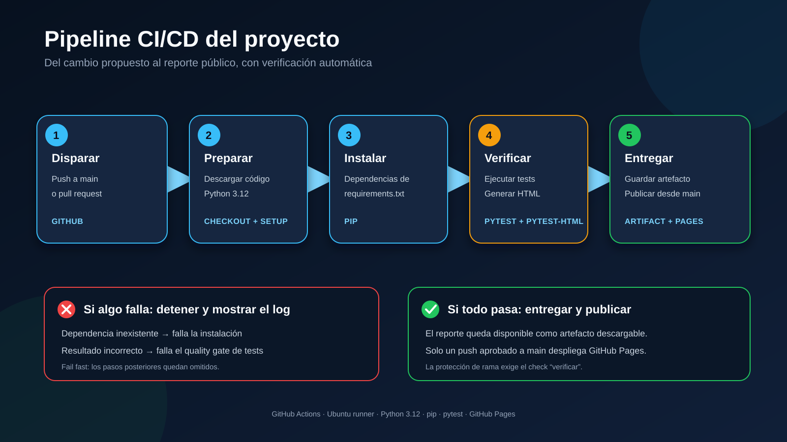

# Trabajo práctico: pipeline CI/CD

[](https://github.com/Benjigamer007/tp-pipeline-cicd/actions/workflows/ci.yml)

Trabajo práctico de Fundamentos de Ingeniería de Software sobre integración y entrega continua. El proyecto usa un programa pequeño para concentrarse en el proceso: preparar un entorno reproducible, instalar dependencias, ejecutar pruebas, generar un reporte y publicarlo automáticamente.

## Resultado

- [Reporte público de las pruebas](https://benjigamer007.github.io/tp-pipeline-cicd/)
- Pipeline ejecutada en cada pull request y en cada push a `main`.
- Rama `main` protegida: exige pull request y el check `verificar` en verde.
- Evidencias de fallos por causas diferentes y de sus correcciones.



## Conceptos

- **Integración continua (CI):** cada cambio dispara automáticamente la preparación del entorno y las pruebas. El resultado es un veredicto verde o rojo.
- **Entrega continua (CD, delivery):** además de verificar, la pipeline produce un artefacto listo para ser publicado. La publicación se realiza únicamente desde `main`.
- **Despliegue continuo (CD, deployment):** publicaría automáticamente cada cambio aprobado en producción. En este proyecto, GitHub Pages muestra dónde ocurre esa publicación.

## Herramientas utilizadas

| Herramienta | Función |
|---|---|
| Git y GitHub | Versionado, ramas, commits y pull requests |
| GitHub Actions | Ejecución automática de la pipeline |
| Ubuntu runner | Entorno efímero donde se ejecutan los jobs |
| Python 3.12 | Lenguaje y versión reproducible del proyecto |
| pip | Instalación de las dependencias declaradas |
| pytest | Ejecución de las pruebas automáticas |
| pytest-html | Generación del reporte HTML |
| GitHub Artifacts | Almacenamiento temporal del reporte |
| GitHub Pages | Publicación web del reporte aprobado |

## Flujo de la pipeline

El workflow está versionado en `.github/workflows/ci.yml` y se activa ante:

- Un pull request hacia `main`.
- Un push a `main`.
- Una ejecución manual desde GitHub Actions.

El job `verificar` realiza estos pasos en orden:

1. Descarga el código con `actions/checkout`.
2. Prepara Python 3.12 con `actions/setup-python`.
3. Instala `requirements.txt` con pip.
4. Ejecuta pytest y genera `site/index.html`.
5. Guarda el reporte como artefacto descargable.

El job `publicar` depende de `verificar` mediante `needs`. Solo se ejecuta ante un push a `main`; por eso los cambios de un pull request se verifican, pero no se publican antes de ser aprobados.

## Fallos controlados

Se provocaron dos errores diferentes para comprobar la lectura de logs:

| Situación | Paso que falla | Motivo |
|---|---|---|
| Un test espera `6`, pero la función devuelve `5` | Ejecutar pruebas | El entorno está preparado, pero el comportamiento no cumple la expectativa |
| Se declara una dependencia inexistente | Instalar dependencias | El runner no puede preparar el entorno y omite las pruebas |

Este comportamiento demuestra **fail fast**: al fallar un paso, la pipeline no continúa con tareas que dependen de él.

## Ejecución local

```bash
python -m venv .venv
python -m pip install -r requirements.txt
python -m pytest -v
```

Para generar el mismo reporte HTML:

```bash
python -m pytest -v --html=site/index.html --self-contained-html
```

## Preguntas de control

| Cambio | Consecuencia esperada |
|---|---|
| Quitar `checkout` | El runner no obtiene los archivos del repositorio |
| Quitar `setup-python` | Se pierde el control explícito de la versión de Python |
| Quitar la instalación | Pueden faltar pytest o sus complementos |
| Ejecutar tests antes de instalar | La verificación puede fallar por herramientas ausentes |
| Quitar pytest | La pipeline podría quedar verde sin verificar el programa |
| Quitar `needs: verificar` | La publicación dejaría de depender explícitamente de las pruebas |
| Quitar la condición de `main` | Se podría intentar publicar código todavía en revisión |
| Quitar la protección de rama | Se podría fusionar un cambio aunque el check esté rojo |

## Uso de inteligencia artificial

Se utilizó IA como asistencia para proponer la estructura inicial del workflow, revisar su sintaxis, planificar situaciones de fallo y mejorar la documentación. Las sugerencias no se aceptaron sin validación: cada cambio se ejecutó localmente y en GitHub Actions, se revisaron los logs y se corrigieron los resultados cuando fue necesario.

La IA ayudó a anticipar preguntas como qué ocurriría al eliminar un paso, pero la evidencia final proviene de ejecuciones reales registradas en el repositorio.
